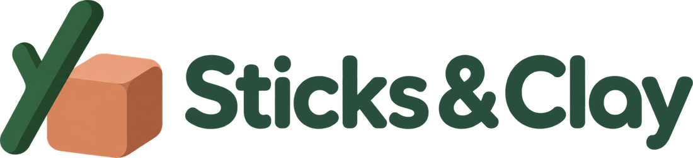
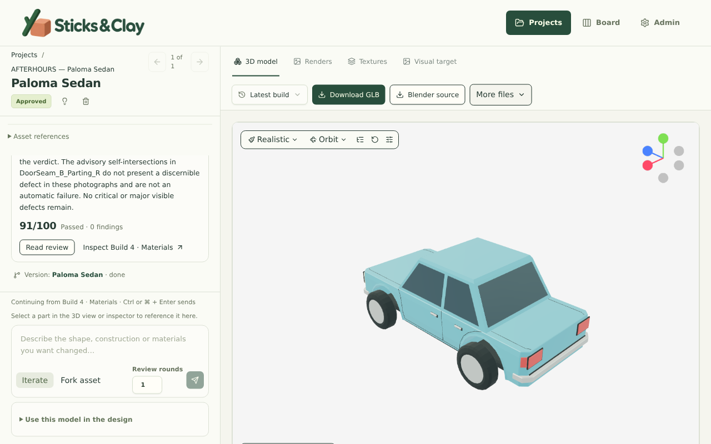
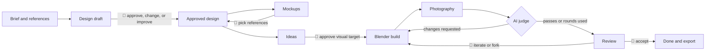
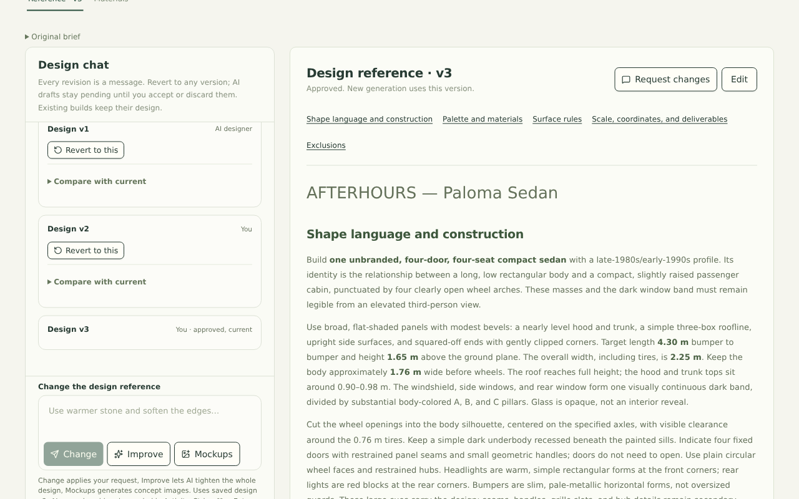
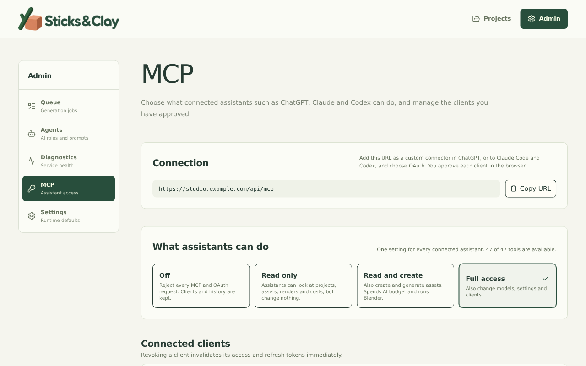
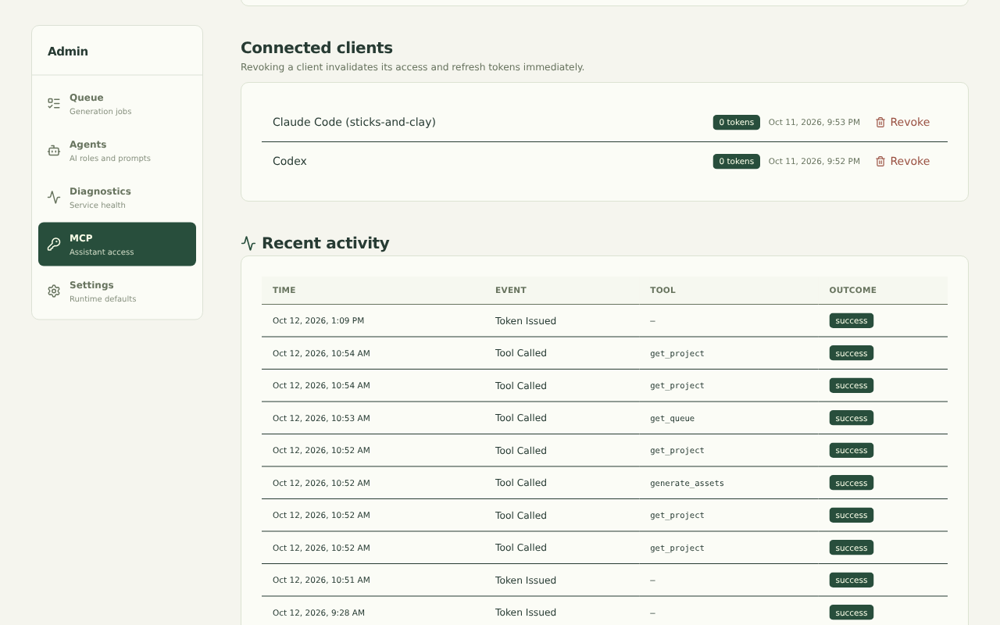
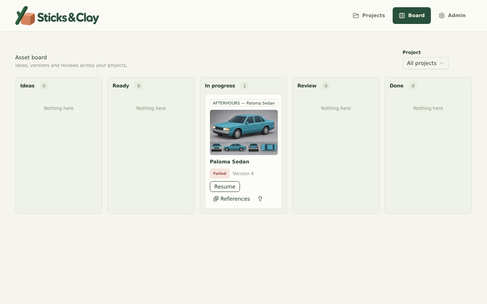
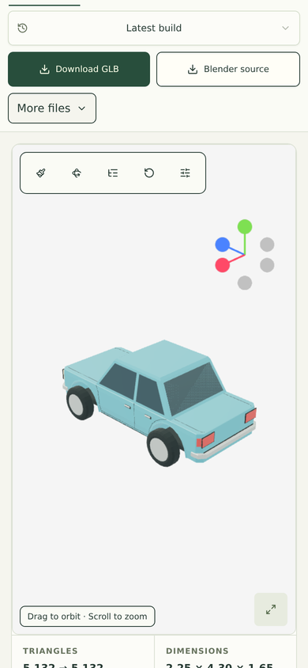
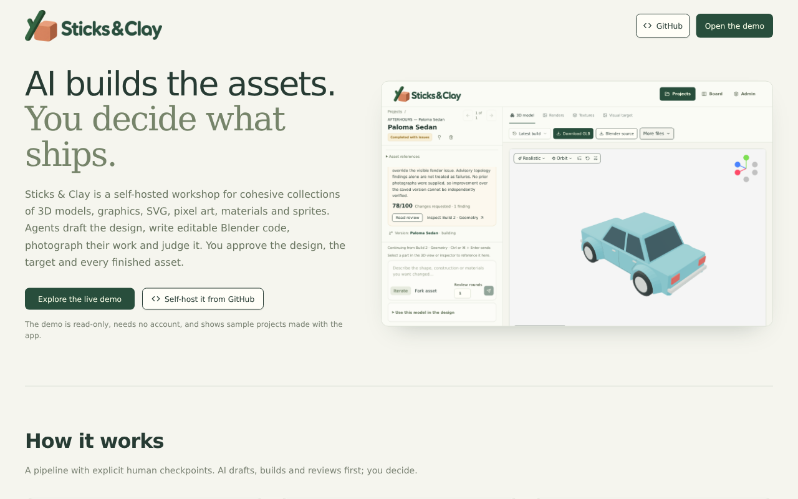
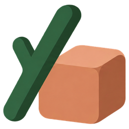

<!-- markdownlint-disable MD033 -->
<p align="center">
  
</p>

<p align="center">
  <strong>An AI asset-generation pipeline with a human in the loop.</strong><br>
  Approve the design, approve the target, review every build. Agents write
  Blender code, judges inspect the renders, and you decide what ships.
</p>

<p align="center">
  <a href="#-quick-start">Quick start</a>
  &nbsp;·&nbsp;
  <a href="#-connect-your-agent-over-mcp">MCP</a>
  &nbsp;·&nbsp;
  <a href="#-documentation">Documentation</a>
  &nbsp;·&nbsp;
  <a href="design.md">Design guide</a>
</p>

<p align="center">
<a href="https://github.com/michidk/sticks-and-clay/actions/workflows/verify.yml">
</a>
<a href="https://github.com/michidk/sticks-and-clay/actions/workflows/image.yml">
</a>
<a href="LICENSE"></a>


</p>

---

## 🧱 What it is

Sticks & Clay is a self-hosted workshop for cohesive collections of **3D models,
graphics, SVG artwork, pixel art, procedural PBR materials, and sprites rendered from 3D**.
You describe a collection once; AI agents draft the design, write editable
Blender Python, render product shots, and judge their own output. You stay in
charge at every step that matters.

<p align="center">
  
</p>

Assets keep one identity from Ideas through Ready, In progress, Review, and
Done. Each generation creates a version; accepting the result is your decision.
Use the global board to review all projects, with project labels and filtering.
Assets can contain named parts and carry their own reference images. New
versions freeze their design and references. See [the asset vocabulary and
lifecycle](docs/asset-lifecycle.md).

Every model is a real Blender file you can open, edit, and rebuild. Every
attempt, review, render, and dollar spent stays in its history, including the
ones that failed.

## 🔁 How it works

Generation is a pipeline with explicit human checkpoints. AI does the
drafting, building, and first-pass review; nothing moves forward on a design
you have not approved.



1. **Design.** Your brief becomes design v1 exactly as written. Approve it,
   request a change, or let AI improve it. Every revision is kept and
   revertible.
2. **Mockups.** Optionally generate concept images, revise them in chat, and
   mark the ones you like as references for every later batch.
3. **Ideas.** Add 1–20 deliverables per idea. Start now or save them for later;
   each batch snapshots the approved design so later edits never change it.
4. **Visual target.** Before a 3D build, review a concept sheet of the asset and
   approve or revise it, or skip it.
5. **Build and judge.** Agents run blockout, shape refinement, materials, and
   polish passes in isolated Blender processes. A vision judge inspects the
   rendered views and sends fixes back until the asset passes or the review
   rounds are spent.
6. **Review.** Accept finished assets, iterate on them with a written request,
   or fork a variant. The stage strip and the global board track everything
   from Ideas to Done.

<p align="center">
  
</p>

## 🤖 Connect your agent over MCP

The whole workshop is available to your own agents through a built-in,
**OAuth-protected remote MCP server** at `/api/mcp`. Claude Code, Codex,
ChatGPT, or any MCP client can create collections, approve designs with you,
queue builds, view renders as pixels, and download GLBs, without a companion
skill or a copied token.

```sh
claude mcp add-json --scope user sticks-and-clay \
  '{"type":"http","url":"https://your-workshop.example/api/mcp","oauth":{"scopes":"sticks-and-clay:read sticks-and-clay:write sticks-and-clay:admin"}}'
claude mcp login sticks-and-clay

codex mcp add sticks-and-clay --url https://your-workshop.example/api/mcp
```

- **51 tools** cover the workshop: projects, designs, assets, versions, generation,
  visual-target approval, branching, materials, renders, sprites, imports,
  exports, recovery, settings, and diagnostics.
- **Agents keep the human in the loop too.** Server instructions, the
  `sticks-and-clay://workflow` resource, and the `create_collection` prompt
  tell agents to show you designs and visual targets before approving them.
- **Three scopes**, granted by you per client on a browser consent page:
  `read`, `write` (paid generation and Blender), and `admin`.
- **Real OAuth.** Authorization code with mandatory PKCE, resource binding,
  rotating refresh tokens with replay detection, and immediate revocation.
- **Artifacts as data.** `view_image` returns render pixels to vision models;
  `read_artifact` serves models, ZIPs, and source bundles over authenticated
  downloads.
- **One switch in the UI.** Admin → MCP sets the access level for every
  client, lists connected clients with revoke buttons, and logs each tool call.

<p align="center">
  
  
</p>

See [MCP setup for Codex, Claude, and ChatGPT](docs/mcp.md) for owner
configuration, scopes, and deployment behind an auth proxy.

## ✨ Features

- 🧊 **Editable 3D, not black-box meshes.** Builders write Blender Python; you
  download the GLB, the `.blend`, and a source bundle that rebuilds without an
  agent or database.
- 👁️ **Judged by renders.** Up to seven product views per build, technical mesh
  analysis, and a vision judge that compares against the approved visual
  target. "Completed with issues" stays distinct from approval and from
  technical failure.
- 🎨 **Graphics and SVG.** One-shot images through an OpenAI-compatible Image
  API, or editable vector artwork with previews, variants, and safe SVG output
  (no scripts, external content, or embedded rasters).
- 👾 **Pixel art.** Drawn cell by cell on a grid (a palette and one row of text
  per row) instead of generated, rendered exactly by the app, reviewed against
  cell-level measurements, and shown enlarged without smoothing.
- 🧪 **Procedural PBR materials** generated as recipes, previewed live, and
  assigned to models.
- 🎞️ **Sprites from 3D.** Render pixel or smooth sprite sheets with 1, 4, or
  8 directions, animation frames, and shared palettes, plus LODs.
- 🗂️ **Board and export.** Ideas → Ready → In progress → Review → Done, and a
  ZIP export of accepted assets.
- 🔁 **Durable jobs.** A PostgreSQL-backed worker with checkpoints, resume,
  and retry that survives restarts and lost sandboxes.
- 💸 **Honest costs.** Every request is recorded with snapshotted rates and
  usage provenance, including cancelled and failed attempts.
- 📱 **Desktop and phone.** The full workflow, including the 3D viewer, works
  on a small screen.

<p align="center">
  
  
</p>

## Read-only demo

The demo includes a public homepage and an exported project you can explore
without a database or AI credentials. Generation and changes are disabled.
Build it with `bun run build:demo`; see [the demo guide](docs/demo-mode.md).

<p align="center">
  
</p>

## 🧰 Tech stack

| Layer | Choice |
| --- | --- |
| Runtime | Bun 1.4, Node 24 |
| Web | React 19, TanStack Start and Router, Vite, Tailwind 4, shadcn/ui |
| 3D viewer | Three.js with React Three Fiber |
| Data | PostgreSQL 17 with Drizzle; local or S3-compatible file storage |
| Agents | Eve agent runtime, TanStack AI, any OpenAI-compatible provider |
| Modeling | Blender 4.5 LTS in isolated processes behind a loopback MCP service |
| Agent access | MCP TypeScript SDK v2 with OAuth and PKCE |
| Deployment | Docker image on GHCR, Kubernetes manifests in a separate repo |

## 🚀 Quick start

On Linux, macOS, or WSL, install Bun 1.4+, Node 24+, Python 3.11+, Blender 4.5
LTS, and Docker. The lockfile pins JavaScript dependencies; Python
dependencies are pinned in `blender/requirements.txt`.

```sh
bun install --frozen-lockfile
cp .env.example .env
python3 -m venv .venv
.venv/bin/python -m pip install -r blender/requirements.txt
```

Edit `.env` privately. Set `EVE_PASSWORD` to a random secret of at least 32
characters. Set `OPENAI_API_KEY` and `OPENAI_BASE_URL` for your provider, or
use an existing Codex provider configuration. The app, worker, and Eve must
use the same credentials and storage settings. Set `BLENDER_BIN` if Blender is
outside your `PATH`.

Start PostgreSQL, apply migrations, and start the background services:

```sh
docker compose -p studio up -d --wait
bun run db:migrate
bun run services
```

Leave the supervisor running. In another terminal, start the web app:

```sh
bun run dev --port 3000
```

Open <http://localhost:3000>. Eve listens on `127.0.0.1:33441`, Blender MCP on
`127.0.0.1:33442`, and PostgreSQL on `127.0.0.1:55439`. The supervisor also
starts the durable worker. For a production build, run `bun run build`, then
`PORT=3000 bun .output/server/index.mjs`, and keep the background services
running separately. `bun run build:demo` builds the read-only public demo
with its landing page; see [the demo guide](docs/demo-mode.md).

On Windows, use WSL for the service launcher. See
[development and operations](docs/development.md) for troubleshooting,
container deployment, storage, and persistence.

> [!WARNING]
> Generation calls paid providers, and generated Blender scripts run with the
> service user's filesystem permissions. Sticks & Clay is a single-owner
> workshop: keep the web UI behind authentication when deployed and keep Eve
> and Blender on loopback. Only the MCP paths carry their own authentication.

## ✅ Verify changes

```sh
bun run verify
```

This runs application and Eve type checks, unit tests, and the production
build. Database tests need a separate migrated PostgreSQL database with no
running worker; Python and real Blender checks run separately. See
[verification commands](docs/development.md#verification).

## 📚 Documentation

| Guide | What is inside |
| --- | --- |
| [MCP setup](docs/mcp.md) | Connecting agents, scopes, OAuth, deployment |
| [Asset workshop](docs/asset-workshop.md) | Materials, sprites, imports, mockups, source bundles |
| [Quality pipeline](docs/quality-pipeline.md) | Modeling passes, reviews, recovery |
| [AI architecture](docs/ai-architecture.md) | Roles, providers, accounting, durable execution |
| [Model processing](docs/model-processing.md) | GLB export cleanup and technical analysis |
| [Model viewer](docs/model-viewer.md) | Camera modes, screenshots, component options |
| [Prompt guide](prompts/README.md) | Authored instructions and third-party attribution |
| [Design guide](design.md) | Interface theme and component conventions |
| [Development and operations](docs/development.md) | Source map, services, persistence, tests |
| [Read-only demo](docs/demo-mode.md) | Landing page, demo fixtures, Vercel build |

## 📁 Project layout

```text
src/routes/        File routes, project workspace, admin pages
src/components/    Shared UI, shadcn primitives, 3D and material viewers
src/lib/           API, pipeline coordination, checkpoints, recovery
src/modules/ai/    Typed AI roles, providers, usage and pricing
src/modules/mcp/   MCP tools, artifacts, and OAuth
src/db/, drizzle/  Schema and migrations
eve/agent/         Agent tools and capability-scoped workspaces
blender/           Isolated Blender execution, export, analysis, materials
prompts/           Authored role instructions and templates
scripts/           Service supervisor, worker, migrations, demo build
demo/              Exported projects shown by the read-only demo
```

PostgreSQL, `data/`, and Eve session storage form one recoverable state; back
them up together. Credentials, generated assets, build output, and local tool
state stay out of the repository.

## 📄 License

[MIT](LICENSE). Third-party prompt references keep their
[attribution and license notices](prompts/references/SOURCES.md).

---

<p align="center">
  <br>
  <sub>Sticks for structure, clay for form. You for judgment.</sub>
</p>
